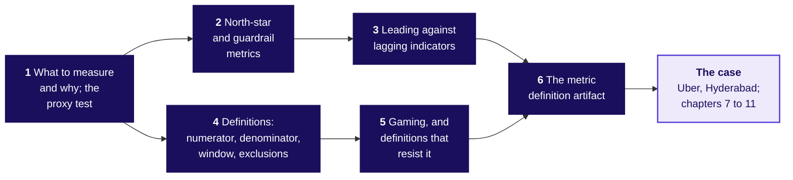

# Business metric design: which number should the plan chase, and what stops it being gamed?

Week 4, Monday. About 12 minutes to read; the take-home's self-check,
`takehome/C2_W04_D01_selfcheck_STUDENT.md`, takes 10 more.

Monday teaches six topics on everyday examples whose numbers are invented and small enough to count
by hand: a school canteen, a driving school, a cricket chase, one student's register and Balaji
Kirana, a corner shop in Hyderabad. Then Uber's Hyderabad driver app uses all six to judge a
peak-hour earnings guarantee. Illustrative case: the company is real, the situation and the data are
synthetic, built for this class.

---

## What can you do after Monday?

- You can test whether a team could raise a number while the goal got no better.
- You can pick one north star and the guardrails that catch the harmful ways of hitting it.
- You can tell a number that warns from one that confirms.
- You can write the four lines that make a number computable.
- You can name four ways a paid number is gamed and the line that stops each.
- You can fill the seven-line page a company adopts.

## Which map holds the day?

Chapters 1 to 3 choose the number; chapters 4 and 5 write it down so it cannot be gamed; chapter 6
puts both on one page.

---

## What to measure and why; the proxy test: what is a number for?

**Who needs the answer.** A school canteen's owner (invented), whose kitchen cooks rice to the token
count and who pays the servers by it.

**The questions on the way.** What is a number for? What happens once people are paid on it?

A **metric** is a number a person watches in order to decide something; a **target** is a metric with
a value somebody is asked to hit. The canteen (invented) serves 200 plates a day and hands a token
with each. From day 6 the servers are paid per token, and tokens go from 200 a day to 400 while
plates stay at 200: tokens per plate rise from 1.0 to 2.0. Cooking 150 g for every token, the
kitchen cooks 60 kg for 30 kg eaten: Rs 1,500 thrown away a day at Rs 50 a kg.

A **proxy** is a number that stands in for the thing wanted. The **proxy test** asks whether a team
could hit the number while the thing it stands for got worse or stayed the same. Any target bends
behaviour toward itself. Wells Fargo judged staff on products sold, through sales targets and
bonuses, and showed investors a cross-sell number, products per household (cross-selling is selling
an existing customer one more product); both counted accounts
nobody used, and the bank paid USD 185 million in penalties in 2016 to two US regulators and Los
Angeles (checked 13 October 2026).

**In the interview.** [S] How would you measure the success of a new feature? Name a number that
is hard to raise while what the feature is for gets no better. Chapter 7 tests Uber's hours.

## North-star and guardrail metrics: which number to chase?

**Who needs the answer.** A family choosing a driving school (invented) from its hoarding.

**The questions on the way.** Why did the hoarding's rate rise? Which number catches the move?

The school has four instructors with 25 learners each. In 2025 all 100 took the licence test and 60
passed, 0.60. In 2026 the instructors booked the test only for the learners they were surest of: 40
took it and 36 passed, 0.90. The rate rose by half while 24 fewer learners got a licence: licences
per learner who enrolled fell from 0.60 to 0.36, which is 0.90 x 0.40.

A **north star** is the one number that best captures the value the people served get: licences
per enrolled learner. The hoarding chased the pass rate instead. A **guardrail** is watched beside the
number being chased so that hitting it does no hidden harm: beside the pass rate, the share who took
the test, 1.00 then 0.40, catches this move. A rate can rise because its denominator
shrank, a **seesaw**, so print the count beside the rate. Swiggy's letter says Maxxsaver, Instamart's
extra discount on bigger carts, sometimes brings "a slightly lower number of orders by the same user";
it puts the slower order growth down to that and to letting go of some low-value orders and
unprofitable users, credits the 16 percent rise in average order value, to Rs 612, to wider selection
and Maxxsaver, and says the ramp-up kept contribution flat (checked 13 October 2026). Orders per user
alone would read that quarter as a fall, and order value alone as a success.

**In the interview.** [F] North-star against guardrail, with one example pair. Chapter 9 gives
Uber's.

## Leading against lagging indicators: which number warns?

**Who needs the answer.** A T20 captain (invented), who can change the batting order after over 10
and cannot change the scoreboard after over 20.

**The questions on the way.** When does the chase first look lost? When is the loss confirmed?

The other side made 159, so 160 wins in 20 overs (invented). Six an over for ten overs makes 60 for
3, so 100 are still needed from 10 overs: 10.0 an over, up from 8.0 at the start. The side ends on
147 and loses by 12, which the scoreboard confirms only after over 20.

A **leading indicator** moves before the north star, while the team can still act, and history
shows it predicts the north star; a **lagging indicator** confirms the north star after the result is
fixed. Read a leading number beside its
guardrail, the wickets a side loses by swinging at every ball: 10 an over with 7 wickets in hand is a
different chase from 10 an over with 2. Timing and
job are separate questions, so one number can be a guardrail and a leading number at once. On the
case, Uber's share of offers accepted fell to 0.729 in the launch week and stayed there, while
bookings per online hour kept falling for two more weeks.

## Definitions: numerator, denominator, window, exclusions: which four lines?

**Who needs the answer.** A principal (invented) printing one attendance figure on a transfer
certificate, and two clerks who must compute it alike.

**The questions on the way.** How many numbers can one register give? Which line moved each?

Week 1 Monday wrote every rate as a **numerator** over a **denominator**. Two more lines finish the
job: the **window**, the stretch of time the count covers, and the **exclusions**, what leaves both
counts, with the date of any change. A count, such as licences in a year, has no denominator; in its
place it says what one unit is and how repeats are removed. One student's 60-day term (invented) holds 10 holidays, so 50
working days: present 40, absent 8, medical leave 2.

| The line that changed | Reading |
|---|---|
| None, the school's rule: 40 / 50 | 80.0 percent |
| Denominator, calendar days: 40 / 60 | 66.7 percent |
| Exclusions, medical leave out of both counts: 40 / 48 | 83.3 percent |
| Numerator, medical leave counted present: 42 / 50 | 84.0 percent |
| Window, the last 20 working days: 14 / 20 | 70.0 percent |

Every reading is honest, and only a written definition says which one the certificate means; with
a scholarship (invented) set at 75 percent, the wrong line costs the student. Delhi Metro's "line
utilisation" count read 45,35,932 on 29 May 2018 against nearly 27 lakh riders a day that February,
since a rider changing across three lines counts three times: a new unit and a new window at once,
and after the change Delhi Metro did not share the old daily figure (checked 13 October 2026).

**In the interview.** [F] What makes a metric gameable, and how do you write one that is not?

## Gaming, and definitions that resist it: how is a number gamed?

**Who needs the answer.** The owner of Balaji Kirana (invented), who pays the delivery boy Rs 20 per
delivery marked done.

**The questions on the way.** What can rise with no parcel delivered? Which line stops each way?

**Gaming** is raising a number without doing what it stands for: false reporting, which receipts and
audits stop, or honest work steered to the count, which pay design and guardrails catch. In four
weeks the boy marked all 50 orders done and customers confirmed 40 with their OTP, the one-time code
read out at the door: Rs 1,000 paid on his count against Rs 800 on theirs. On the dispatch time he
types himself every order is on time; on the shop's bill clock 35 of 50 are, 0.70. All 6 complaints
sit on the 10 orders with no OTP.

| How it is gamed | At the shop (invented) | In public, or in the case | The line that stops it |
|---|---|---|---|
| The paid person controls the count | The boy presses done | The illustrative Uber case: an open app counts as online | A count the person served confirms |
| No receipt or use is needed | Done with no OTP | Wells Fargo: accounts nobody used | A receipt condition in the numerator |
| The person timed starts the clock | He types the dispatch time | US Veterans Affairs: the next open slot typed as the "desired date" | A clock the system starts |
| A quiet change of definition | Attempts start to count | Wells Fargo, 2013: accounts for sending money abroad added | Changes dated on the page |

A definition resists gaming when its numerator needs a receipt, its denominator is set by someone
other than the people paid, its clock starts at a time the system records, its exclusions are dated,
and it says what it does not reward. At Phoenix, 30 of the 40 primary-care schedulers and
supervisors asked said they set the desired date from the next open appointment, so long waits read as
zero days (checked 13 October 2026).

## The metric definition artifact: what does the page hold?

**Who needs the answer.** The shop's owner, whose son wants "deliveries up 20 percent".

**The questions on the way.** What are the seven lines? What does a weak page lack?

The **metric definition artifact** is one page a company adopts, so teams argue about one written
thing. Four lines make the number computable: numerator, denominator, window, exclusions. Three make
it safe to pay for: what it does not reward, the guardrails, and the gaming note, which says what
each guardrail catches. "Deliveries, monthly, plus 20 percent" holds two lines; "plus 20 percent" is a
target, which says how much and never what.

| Line | Balaji Kirana's page (invented) |
|---|---|
| Numerator | Deliveries confirmed with the customer's OTP |
| Denominator | Orders billed that week, the count printed beside the rate |
| Window | The calendar week |
| Exclusions | Orders cancelled before dispatch, each change dated |
| Not rewarded | A done press with no OTP, a typed dispatch time, a shrinking order count |
| Guardrails | Complaints per 100 orders billed; confirmed deliveries within 30 minutes of the bill |
| Gaming note | Complaints catch an OTP asked for by phone; the bill clock catches a dispatch time typed late |

Over four weeks it reads 40 of 50, 0.80, with its guardrails at 12 per 100 and 0.75. A growth target
added as a guardrail, such as orders up 20 percent, catches nothing, so it never earns a line.

**In the interview.** [D] Three departments each want their own target; how do you get to one, and
what do you say to the two who lose?

---

## The case: what did six drivers, then 12,860 driver-weeks, say?

**Who needs the answer.** Uber's Hyderabad city head, who decides on Friday whether to extend the
peak-hour guarantee to two more cities.

**The questions on the way.** What does the ticket say? What do six drivers say by hand? What do
the full tables say, and where does the fall sit?

**The ticket.** From Monday 31 August 2026 an enrolled driver online through a whole peak window is
guaranteed Rs 300 per peak online hour, and Uber tops up the gap. Six weeks on, peak online hours are
up 24 percent, completed peak trips up 3 percent, trips per peak online hour down from 1.90 to 1.58,
and Rs 1.9 crore has been paid in top-up. The caveats: the monsoon ended inside the window, 140
drivers are new, the app counts a driver as online whenever it is open, and three outer zones get few
requests.

**Chapter 7, by hand, applying the proxy test and the four definition lines.** Six drivers, one week
before and one after: hours 60 then 74, trips 114 then 88, so trips per peak online hour fell from
1.90 to 1.19. Drivers E and F, in Shamshabad and Rajendranagar, went to 16 and 14 hours with 3 and 2
trips. Hours fail the proxy test: an open app needs no rider.

**Chapter 8, the full tables, applying the definition lines and gaming.** Rider requests rose 1.8
percent, so demand did not fall. Averaging each driver-week's rate prints 1.71 and hides two-fifths
of the fall; the ratio of the sums, 1.58, is the number. 180 drivers, 15 percent, made under one trip
an hour after the launch, the **idle tail**: hours 2.1 times their level before, trips 0.88 times,
and 72 percent of their new hours in the three outer zones. The fall survives the 140 new drivers
(still 1.58) and the three busiest weeks (1.60).

**Say it to a driver.** "Most of you drove as before; about one driver in seven sat online where
nobody was asking."

## The case: what should the scheme pay for, and what did paying for hours cost?

**Who needs the answer.** The city head, who signs the next six weeks, and the finance partner.

**The questions on the way.** What did hours cost? What does the page say?

**Chapter 9, applying the north star and guardrails, leading inputs, gaming and the page.** Rs 1.159
crore of the Rs 1.9 crore, 61 percent, went to driver-weeks that accepted fewer than half their
offers. The page the room fills:

| Line | The redesign |
|---|---|
| Numerator | Trips completed inside the peak windows, one per paying rider |
| Denominator | Enrolled drivers online at least one peak hour that week, the count printed |
| Window | The calendar week |
| Exclusions | Trips cancelled by either side, test accounts, trips outside the windows |
| Not rewarded | Hours online; declines; a shrinking enrolled base |
| Guardrails | Riders: accepted share over an acceptance floor, read with the cancel share; median wait. Budget: top-up per trip |
| Gaming note | Declining, cherry-picking and accept-then-cancel; lost supply; a runaway top-up |

The north star read 35.76 trips per online driver-week before and 35.89 after, while acceptance fell
from 0.863 to 0.730 and the top-up cost Rs 82.3 a trip. The leading inputs are drivers online in the
first peak hour and requests per online hour by zone. The explorer
(`demos/C2_W04_D01_week_explorer_STUDENT.html`) draws the drift, the seesaw, the page and the lead.

## The case: does the page survive the roles, and what wins the interview?

**Who needs the answer.** The three people who lose something under a change, and you, in a product
screen.

**The questions on the way.** What do the roles say? What would the redesign save? What does a
hire-grade answer do?

**Chapter 10, applying gaming and the page.** Driver operations says drivers will log off: true for
the idle tail, and the wait by zone shows any loss. Marketing says new terms look like bait, so the
Rs 300 floor stays for drivers who clear the acceptance floor. Finance blames the monsoon, and the
rate stepped down in the launch week itself. The weeks under half accepted are exactly the idle
tail's, so keeping the Rs 300 floor only for weeks that accept at least half saves Rs 92.7 lakh if a
fifth of the idle tail's top-up is still paid and Rs 58 lakh if half is, an assumption a test
settles.

**Chapter 11, applying all six.** A hire-grade answer clarifies the goal and the decision, then
gives a north star with its lines, three guardrails, a leading input and a test with its unit
named: drivers cross zone lines, so the candidate switches the whole city between the old rule and the
new one, window by window. Weak: "hours are up 24 percent, so it works." Hire-grade: "trips per online
hour fell from 1.90 to 1.58, stepping down in the launch week; I would not extend it, and would test
the Rs 300 floor kept only for weeks that accept at least half their offers." For an AI coding assistant, suggestions accepted is the proxy, and
suggested text still in the code at the next commit is the outcome.

## Which words did Monday use?

| Term | What it means |
|---|---|
| Metric | A number a person watches in order to decide something |
| Target | A metric with a value somebody is asked to hit |
| Proxy | A number that stands in for the thing wanted |
| Proxy test | Could a team hit this number while the thing it stands for got no better? |
| North star | The one number that best captures the value the people served get |
| Guardrail | A number watched beside the number being chased, which must not get worse as it rises |
| Acceptance floor | The least share of offers a driver-week must accept to earn the Rs 300 floor |
| Leading indicator | A number that moves before the north star, while the team can act |
| Lagging indicator | A number that confirms the north star after the result is fixed |
| Window | The stretch of time a count covers |
| Exclusions | What leaves both counts, each change dated |
| Gaming | Raising a number without doing what it stands for |
| Receipt condition | A numerator that counts only what the person served confirmed |
| Metric definition artifact | The seven-line page a company adopts |
| Idle tail | The 180 drivers under one trip per peak online hour after the launch |

## So is the number the scheme pays for measuring what the city wants?

No. Hours rose 24 percent while trips per peak online hour fell from 1.90 to 1.58 and the wait fell
only from 4.8 to 4.6 minutes, and Rs 1.159 crore of the Rs 1.9 crore top-up went to driver-weeks that declined most offers.
Judge the scheme by completed peak trips per enrolled driver online at peak, read with acceptance, the
wait by zone and the top-up per trip, and keep the Rs 300 floor only for weeks that accept at least
half their offers. Tuesday puts that on one slide.
